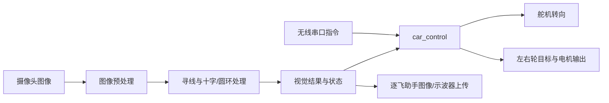

# 整车代码导读

这里介绍 [整车整合版](../firmware/Motherboard_Demo/E07_09_wifi_spi_mt9v03x_demo_left_edge_fix/README.md)。其他外设例程和视觉开发版各有独立 `main.c`，不等于这些功能已经全部合并到同一个程序。

## 模块分工

| 文件 | 主要职责 |
|---|---|
| [user/main.c](../firmware/Motherboard_Demo/E07_09_wifi_spi_mt9v03x_demo_left_edge_fix/user/main.c) | 系统/通信/摄像头初始化，组织图像处理、控制更新和上位机上传 |
| [code/image_process.c](../firmware/Motherboard_Demo/E07_09_wifi_spi_mt9v03x_demo_left_edge_fix/code/image_process.c) | 图像阈值与二值化等预处理 |
| [code/track_edge.c](../firmware/Motherboard_Demo/E07_09_wifi_spi_mt9v03x_demo_left_edge_fix/code/track_edge.c) | 赛道边界与中线提取 |
| [code/cross_road.c](../firmware/Motherboard_Demo/E07_09_wifi_spi_mt9v03x_demo_left_edge_fix/code/cross_road.c) | 十字路口处理 |
| [code/ring_road.c](../firmware/Motherboard_Demo/E07_09_wifi_spi_mt9v03x_demo_left_edge_fix/code/ring_road.c) | 圆环状态与处理 |
| [user/car_control.c](../firmware/Motherboard_Demo/E07_09_wifi_spi_mt9v03x_demo_left_edge_fix/user/car_control.c) | 根据视觉结果生成转向和速度目标，处理启动/停止与调试指令 |
| [user/car_drive.c](../firmware/Motherboard_Demo/E07_09_wifi_spi_mt9v03x_demo_left_edge_fix/user/car_drive.c) | 左右轮目标混合、起步辅助等输出策略 |
| [user/car_motor.c](../firmware/Motherboard_Demo/E07_09_wifi_spi_mt9v03x_demo_left_edge_fix/user/car_motor.c) | PWM、电机方向、编码器与定时控制；是否使用闭环由配置决定 |
| [user/car_servo.c](../firmware/Motherboard_Demo/E07_09_wifi_spi_mt9v03x_demo_left_edge_fix/user/car_servo.c) | 舵机角度、限幅、中位和变化速度处理 |
| [user/car_config.h](../firmware/Motherboard_Demo/E07_09_wifi_spi_mt9v03x_demo_left_edge_fix/user/car_config.h) | 参数与功能开关 |

## 主要数据方向

读代码建议按 `main.c → car_config.h → car_control.c → car_motor.c/car_servo.c → code/` 顺序。先分清“参数默认值”“运行时状态”“历史注释”，再判断一个功能是否真正启用。

本次没有更改视觉算法、控制算法或原车标定；源码变化仅限网络凭据占位替换。工程文件的路径另做了可移植性调整。
